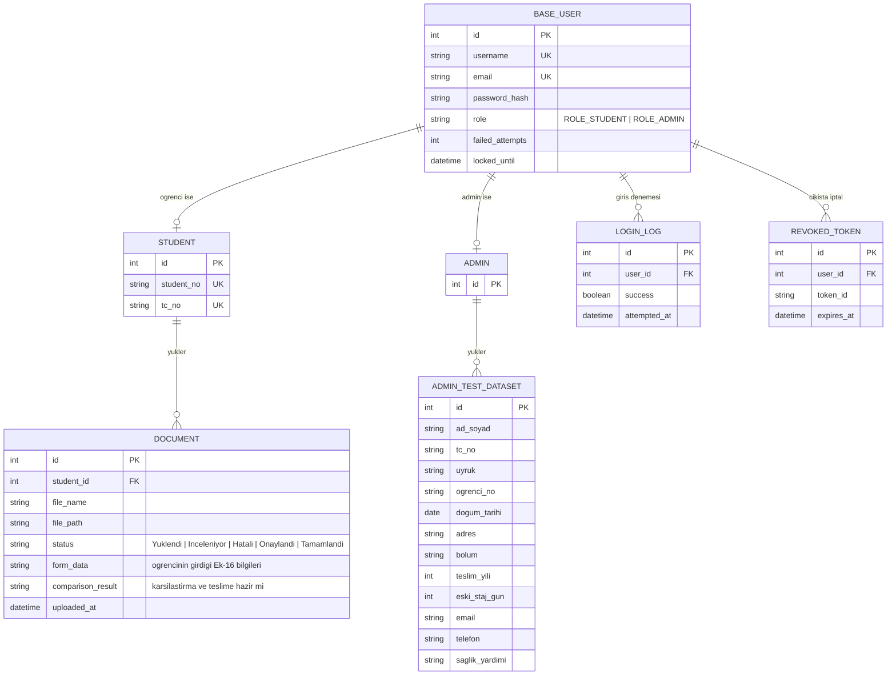

# 01 - Veritabanı ER Diyagramı

Staj Evrak Doğrulama ve Yönetim Sistemi (EF Core + SQLite).

> Tablo adları backend'deki model sınıflarından (`BaseUser`, `Student`, `Admin`, `AdminTestDataset`, `LoginLog`, `RevokedToken`, `Document`) türetildi. Alan adları isterlere göre yazıldı, `backend/StajEvrak.Api/Models/` ile karşılaştırılıp düzeltilmelidir.

## Açıklamalar

- **BASE_USER:** Öğrenci ve admin ortak tablosu. `role` alanı JWT içinde taşınır. `failed_attempts` 5 olunca hesap kilitlenir.
- **STUDENT / ADMIN:** Role özel bilgiler. Kalıtım yapısı sınıf diyagramında.
- **ADMIN_TEST_DATASET:** Adminin yüklediği CSV/Excel verisi. Belgedeki bilgilerle `ogrenci_no` / `tc_no` üzerinden eşleştirilir (yabancı anahtar yok, eşleştirme servis katmanında).
- **DOCUMENT:** Durum akışı Yüklendi, İnceleniyor, Hatalı/Eksik, Onaylandı, Tamamlandı.
- **LOGIN_LOG:** Başarısız girişler loglanır.
- **REVOKED_TOKEN:** Çıkış yapılınca token geçersiz kılınır.
