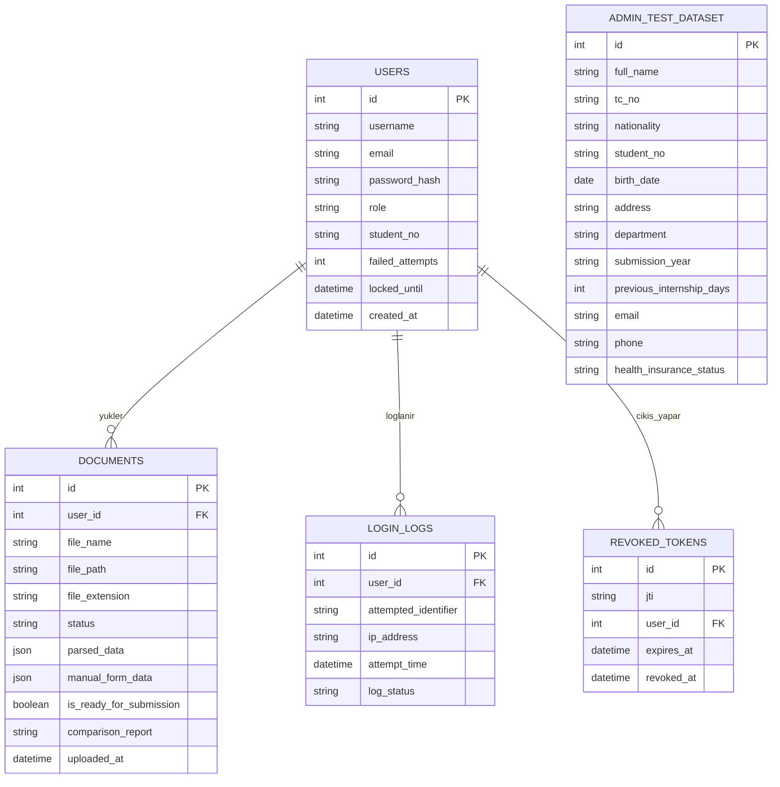

# Veritabanı ER Diyagramı Taslağı (Vize Aşaması)

Bu dosya, 3 ekip üyesinin veritabanı tablo ve sütun isimlerinde birebir aynı yapıyı kullanması için hazırlanmıştır.

## 1. İlişki Özeti (Relationship Summary)
* **`users` (1) ---> (N) `documents`**: Bir öğrencinin sisteme yüklediği birden fazla Ek-16 belgesi olabilir.
* **`users` (1) ---> (N) `login_logs`**: Bir kullanıcının (veya IP'nin) birden fazla başarısız giriş denemesi loglanabilir. Var olmayan kullanıcı adıyla yapılan denemelerde `user_id` NULL kalır.
* **`users` (1) ---> (N) `revoked_tokens`**: Logout yapılan JWT'lerin `jti` değerleri saklanır; bu tablodaki token'lar geçersiz sayılır.
* **`admin_test_dataset`**: Admin tarafından sisteme yüklenen referans öğrenci kayıtlarını tutar. Öğrencinin yüklediği belge ve form verileri bu tablodaki kayıtlarla (TC No / Öğrenci No üzerinden) karşılaştırılır.

---

## 2. Tablo ve Sütun Detayları

### A. `users` (Kullanıcılar Tablosu)
| Sütun Adı | Veri Tipi | Kısıtlamalar / Açıklama |
| :--- | :--- | :--- |
| `id` | INT / UUID | Primary Key (Auto Increment) |
| `username` | VARCHAR(100) | Unique, Not Null |
| `email` | VARCHAR(150) | Unique, Not Null |
| `password_hash` | VARCHAR(255) | Not Null (Bcrypt/Argon2 ile hash'lenmiş) |
| `role` | ENUM | `'ROLE_STUDENT'`, `'ROLE_ADMIN'` |
| `student_no` | VARCHAR(20) | Nullable (sadece öğrenciler; test veri setiyle eşleşme için) |
| `failed_attempts` | INT | Default: `0` (5 olunca hesap kilitlenir, başarılı girişte `0`'lanır) |
| `locked_until` | TIMESTAMP | Nullable. Doluysa ve gelecekteyse hesap kilitlidir (15 dk) |
| `created_at` | TIMESTAMP | Default: `CURRENT_TIMESTAMP` |

### B. `admin_test_dataset` (Admin Test Veri Seti Tablosu)
| Sütun Adı | Veri Tipi | Kısıtlamalar / Açıklama |
| :--- | :--- | :--- |
| `id` | INT / UUID | Primary Key |
| `full_name` | VARCHAR(150) | Öğrenci Ad Soyad |
| `tc_no` | VARCHAR(11) | T.C. Kimlik No / Yabancı Kimlik No |
| `nationality` | VARCHAR(50) | Uyruk |
| `student_no` | VARCHAR(20) | Öğrenci No |
| `birth_date` | DATE | Doğum Tarihi |
| `address` | TEXT | İkametgah Adresi (Açık Adres) |
| `department` | VARCHAR(100) | Okuduğu Bölüm |
| `submission_year` | VARCHAR(20) | Ek-16 Teslim Yılı (Örn: `2025-2026`) |
| `previous_internship_days` | INT | Daha önce yapılan staj gün sayısı |
| `email` | VARCHAR(150) | E-posta |
| `phone` | VARCHAR(20) | Telefon No |
| `health_insurance_status` | VARCHAR(50) | Sağlık Yardımı Statüsü |

### C. `documents` (Yüklenen Ek-16 Belgeleri Tablosu)
| Sütun Adı | Veri Tipi | Kısıtlamalar / Açıklama |
| :--- | :--- | :--- |
| `id` | INT / UUID | Primary Key |
| `user_id` | INT / UUID | Foreign Key (`users.id`) |
| `file_name` | VARCHAR(255) | Orijinal dosya adı |
| `file_path` | VARCHAR(500) | Sunucudaki kayıt yolu |
| `file_extension` | VARCHAR(10) | `.pdf`, `.docx`, `.doc`, `.jpeg`, `.png` |
| `status` | ENUM | `'YUKLENDI'`, `'INCELENIYOR'`, `'HATALI_EKSIK'`, `'ONAYLANDI'`, `'TAMAMLANDI'` |
| `parsed_data` | JSON / TEXT | `.docx`/PDF kütüphanesi ile belgeden otomatik okunan veriler |
| `manual_form_data` | JSON / TEXT | Öğrencinin arayüz formundan manuel girdiği veriler |
| `is_ready_for_submission` | BOOLEAN | Manuel veri, belge verisi ve test seti eşleşme sonucu |
| `comparison_report` | TEXT | Uyuşmazlık varsa detay raporu |
| `uploaded_at` | TIMESTAMP | Default: `CURRENT_TIMESTAMP` |

### D. `login_logs` (Başarısız Giriş Logları Tablosu)
| Sütun Adı | Veri Tipi | Kısıtlamalar / Açıklama |
| :--- | :--- | :--- |
| `id` | INT / UUID | Primary Key |
| `user_id` | INT / UUID | Foreign Key (`users.id`), Nullable |
| `attempted_identifier` | VARCHAR(150) | Girilmeye çalışılan kullanıcı adı / e-posta |
| `ip_address` | VARCHAR(45) | İstek atan IP adresi |
| `attempt_time` | TIMESTAMP | Default: `CURRENT_TIMESTAMP` |
| `log_status` | VARCHAR(50) | `'FAILED_PASSWORD'`, `'UNKNOWN_USER'`, `'ACCOUNT_LOCKED'` |

### E. `revoked_tokens` (Logout ile Geçersiz Kılınan Token'lar)
| Sütun Adı | Veri Tipi | Kısıtlamalar / Açıklama |
| :--- | :--- | :--- |
| `id` | INT / UUID | Primary Key |
| `jti` | VARCHAR(64) | Unique, Not Null (JWT ID claim'i) |
| `user_id` | INT / UUID | Foreign Key (`users.id`) |
| `expires_at` | TIMESTAMP | Token'ın asıl bitiş zamanı (sonrasında satır silinebilir) |
| `revoked_at` | TIMESTAMP | Default: `CURRENT_TIMESTAMP` |

---

## 3. Görsel ER Diyagramı (Mermaid)

