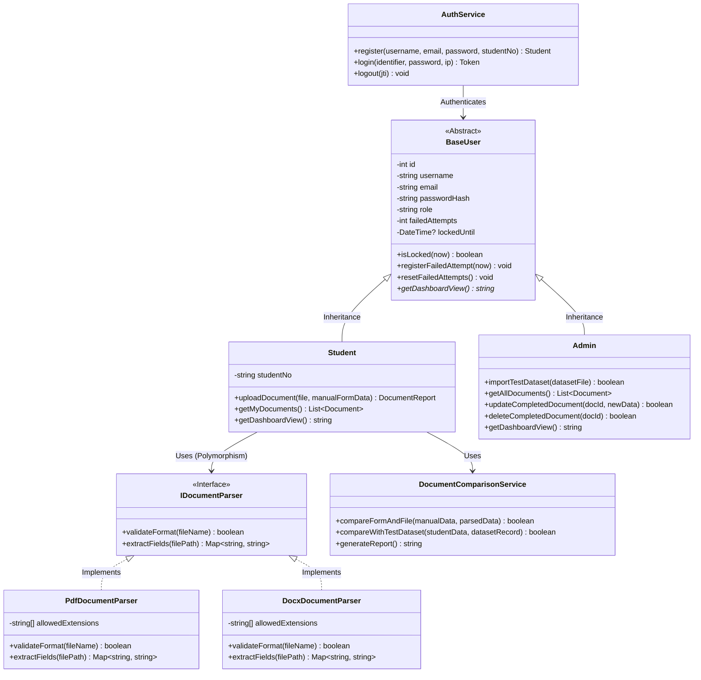

# Nesne Yönelimli Programlama (NYP) Class Diyagramı Taslağı

Bu yapı, projede zorunlu tutulan 4 temel NYP prensibini (**Kapsülleme, Soyutlama, Kalıtım, Çok Biçimlilik**) kod mimarisine doğrudan entegre etmek için hazırlanmıştır.

## 1. NYP Prensiplerinin Uygulanma Yerleri
1. **Kapsülleme (Encapsulation):** Tüm sınıf değişkenleri `private` (`-`) tanımlanır; erişim kontrollü `public` (`+`) getter/setter ve iş metotları üzerinden sağlanır.
2. **Soyutlama (Abstraction):** `BaseUser` soyut sınıfı (`abstract class`) ve `IDocumentParser` arayüzü (`interface`) üzerinden ortak sözleşmeler tanımlanır.
3. **Kalıtım (Inheritance):** `Student` ve `Admin` sınıfları `BaseUser` sınıfından türetilir. `PdfParser` ve `DocxParser` sınıfları `IDocumentParser` arayüzünü uygular.
4. **Çok Biçimlilik (Polymorphism):** `DocumentService` sınıfı, dosyanın türüne göre arka planda hangi parser çalışırsa çalışsın hepsini tek bir `IDocumentParser` tipi üzerinden çağırır (`parser.extractFields(file)`).

---

## 2. Sınıf Diyagramı (Mermaid)

