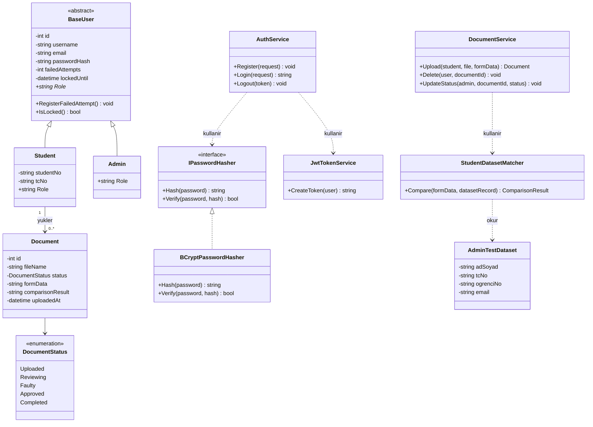

# 02 - NYP Sınıf Diyagramı

> Sınıf adları backend dosyalarından alındı. Üye (alan/metot) adları isterlere göre yazıldı, kodla karşılaştırıp düzelt.

## NYP prensipleri

- **Kapsülleme (Encapsulation):** Şifre hash'i ve deneme sayısı `private`, dışarıdan sadece `RegisterFailedAttempt()` ve `IsLocked()` ile yönetilir.
- **Soyutlama (Abstraction):** `BaseUser` soyut sınıf, doğrudan nesnesi oluşturulmaz. `IPasswordHasher` arayüzü hash algoritmasının ayrıntısını gizler.
- **Kalıtım (Inheritance):** `Student` ve `Admin`, `BaseUser`'dan türer.
- **Çok biçimlilik (Polymorphism):** `Role` her alt sınıfta farklı değer döner. `AuthService`, `IPasswordHasher` üzerinden çalışır, algoritma değişse (BCrypt yerine Argon2) servis değişmez.
