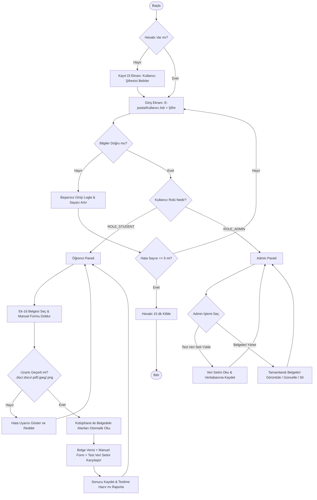

# Sistem Akış Diyagramı (Flowchart) Taslağı - Vize Süreci

Bu diyagram, kullanıcının sisteme girişinden itibaren Öğrenci ve Admin rollerinin vize kapsamındaki tüm işlem adımlarını gösterir.

## 1. Adım Adım Süreç Akışı
1. **Kimlik Doğrulama:** Kullanıcı kayıt olur veya giriş yapar. Başarısız denemeler loglanır; üst üste 5 hatalı şifrede hesap 15 dakika kilitlenir.
2. **Rol Yönlendirmesi:**
   * `ROLE_STUDENT`: Öğrenci paneline yönlendirilir.
   * `ROLE_ADMIN`: Admin paneline yönlendirilir.
   * Yetkisiz erişimlerde HTTP 403 hatası verilir.
3. **Öğrenci Süreci:**
   * Ek-16 dosyası seçilir + arayüzdeki formdan manuel bilgiler girilir.
   * **Uzantı Kontrolü:** Dosya `.doc`, `.docx`, `.pdf`, `.jpeg`, `.png` formatında değilse işlem reddedilir ve uyarı gösterilir.
   * **Belge Okuma:** `.docx`/PDF kütüphanesi ile belgedeki alanlar otomatik okunur (OCR yok).
   * **Karşılaştırma:** Belgeden okunan veriler, manuel girilen form verileri ve veritabanındaki Admin test veri seti karşılaştırılır.
   * Belgenin teslime hazır olup olmadığı raporlanır ve kaydedilir.
4. **Admin Süreci:**
   * Test veri seti yüklenir ve veritabanına işlenir.
   * "Tamamlandı" statüsündeki belgeler görüntülenir, güncellenir veya silinir (Öğrenci bu statüdeki belgeye dokunamaz).

---

## 2. Görsel Akış Diyagramı (Mermaid)

