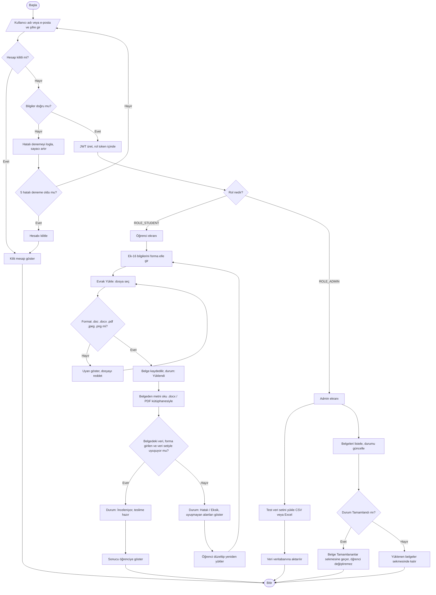

# 03 - Akış Diyagramı (Flowchart)

Giriş, evrak yükleme, karşılaştırma ve belge durum akışı.

## Kurallar

- 5 hatalı denemede hesap kilitlenir, her başarısız deneme loglanır.
- Rol JWT içinde taşınır, yetkisiz istek 403 döner ve login sayfasına yönlendirilir.
- Vizede sadece format/uzantı kontrolü zorunlu. OCR ve ayrıntılı alan doğrulamaları finalde.
- Öğrenci "Tamamlandı" belgeyi değiştiremez veya silemez, admin yapabilir.
