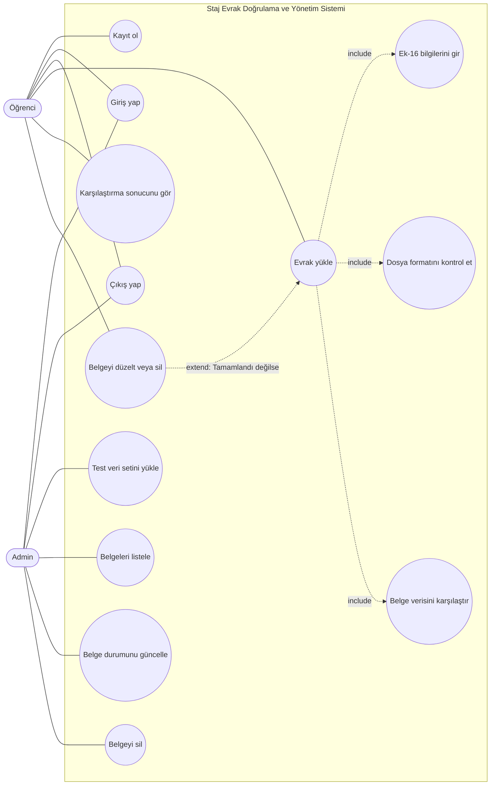

# 04 - UML Use Case Diyagramı

> Mermaid'de doğrudan use case diyagramı yoktur, bu yüzden `flowchart` ile çizildi: yuvarlak kutular aktörleri, oval şekiller kullanım senaryolarını, kesikli oklar `include` / `extend` ilişkilerini gösterir.

## Aktörler

- **Öğrenci:** Kendi hesabını oluşturur, Ek-16 evrakını yükler, bilgilerini elle girer, karşılaştırma sonucunu ve teslime hazır durumunu görür.
- **Admin:** Test veri setini yükler, tüm belgeleri listeler, durumu günceller, belgeyi siler. Tamamlanan belgeleri de değiştirebilir.

## İlişkiler

- **Evrak yükle (include):** Bilgi girme, format kontrolü ve karşılaştırma yüklemenin parçasıdır.
- **Belgeyi düzelt veya sil (extend):** Sadece belge "Tamamlandı" değilse yapılabilir.
