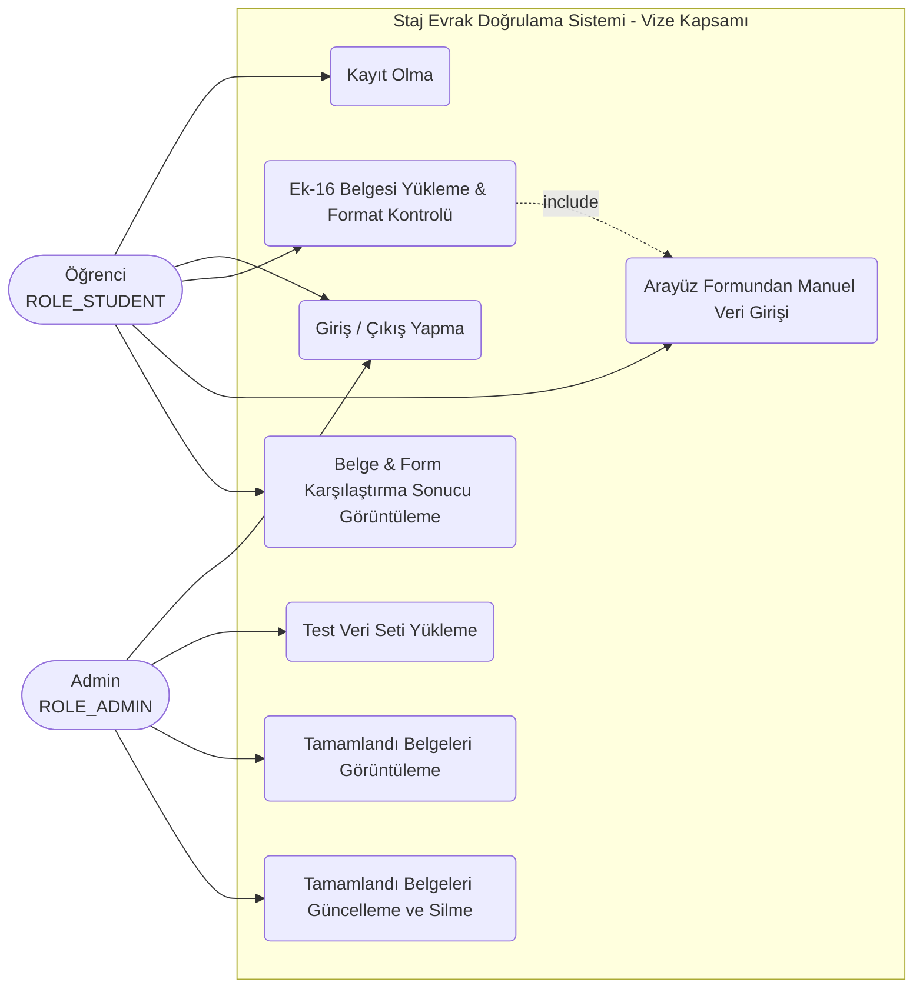

# UML Use Case (Kullanım Senaryosu) Diyagramı Taslağı

Bu diyagram, sistemdeki aktörlerin (`Öğrenci`, `Admin`) vize aşamasında sistemle kurduğu etkileşimleri ve yetki sınırlarını tanımlar.

## 1. Aktörler ve Kullanım Senaryoları

### Aktör: Öğrenci (`ROLE_STUDENT`)
* **UC-01 Kayıt Olma:** Kendi kullanıcı adı, e-posta ve şifresini belirleyerek sisteme kaydolur.
* **UC-02 Giriş / Çıkış Yapma:** Kimlik bilgileriyle oturum açar, çıkışta oturumunu sonlandırır.
* **UC-03 Ek-16 Belgesi Yükleme:** Belirtilen uzantılarda (`.doc`, `.docx`, `.pdf`, `.jpeg`, `.png`) belge yükler.
* **UC-04 Manuel Bilgi Girişi:** Yüklediği belgedeki alanları arayüz formuna manuel olarak girer.
* **UC-05 Karşılaştırma Raporu Görüntüleme:** Belgeden okunan veri ile manuel girdiği verinin eşleşme durumunu görür. *(Not: "Tamamlandı" statüsündeki belgeleri güncelleyemez ve silemez).*

### Aktör: Admin (`ROLE_ADMIN`)
* **UC-02 Giriş / Çıkış Yapma:** Admin yetkisiyle oturum açar.
* **UC-06 Test Veri Seti Yükleme:** Öğrenci doğrulaması için gerekli 12 sütunlu test veri setini sisteme aktarır.
* **UC-07 Başvuruları Görüntüleme:** Sisteme yüklenen tüm belgeleri ve durumlarını listeler.
* **UC-08 Tamamlandı Belge Güncelleme / Silme:** "Tamamlandı" statüsündeki belgeler üzerinde güncelleme ve silme işlemlerini gerçekleştirir.

---

## 2. Görsel Use Case Diyagramı (Mermaid)

